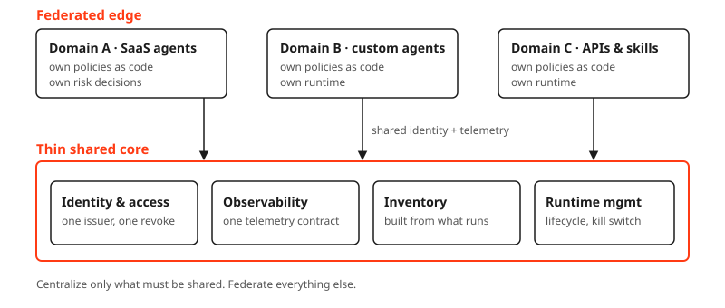
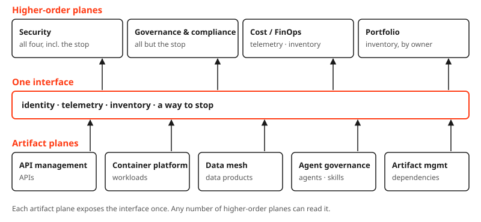
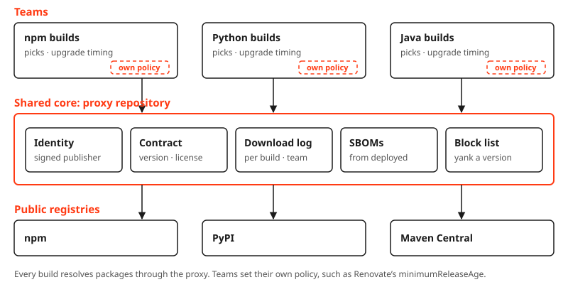
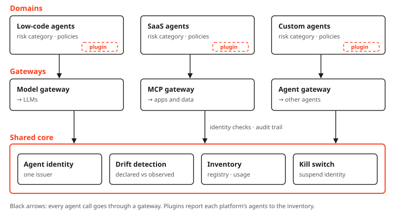

Governance gets easier and friendlier when you centralize less. Agents, MCP servers, skills, even packages and tools appear faster than any board can meet, and teams route around the queue. Govern the few things that must be shared: identity, telemetry, inventory and a way to stop. Let the domains own the rest.

In the good classic style of the Gang of Four, here is that idea as a pattern: a name, a context, the forces that pull it apart, a solution and its consequences.

### Name

**Lightweight control plane.** Federation is the default: domains own their runtimes, their data paths, their meaning and their rules. The control plane holds only what federation cannot work without: who is who, what exists and what it promises, what happened, and a way to stop. It distributes policy; the gateways, brokers and catalogues at each boundary enforce it.

### Context

A central gate does not work. Letting every team do its own thing does not work either. One team's agent has no identity of its own. Another team's logs sit in a vendor console nobody else can open. A third keeps its inventory in a spreadsheet. When something goes wrong, nobody can answer the basic questions:

- Who is this?
- What does it promise?
- What did it do?
- Does it still exist?
- How do I stop it?

And there is no single place to ask. APIs, data products, agents and packages run on different platforms, each with its own console, and that will not change.

### Principles

- **Federate by default.** Domains own runtimes, data paths, meaning and risk decisions. Something moves to the core only when it is useless unless shared: an identity every team issues for itself, or telemetry nobody can correlate.
- **Keep the core thin.** Every capability in the core makes it slower to change. Team Topologies calls the goal the *thinnest viable platform*.
- **Make the compliant path the easiest one.** At thousands of artifacts, nobody reviews by hand, and any friction gets routed around. Platforms, in Gregor Hohpe's words, "reduce cognitive load without restricting choice" ([*Platform Strategy*](https://leanpub.com/platformstrategy)).
- **Enforce at the boundary, not in the registry.** Registering something enforces nothing. A policy counts once it reaches the gateway, event broker or catalogue that guards the boundary.
- **Observe, then compare.** What exists comes from what runs, not from a form. What it promised comes from its contract. The gap between the two is the signal.
- **Same evidence on every runtime.** In a regulated setting you must show who did what, on whose behalf, with which data, the same way across every vendor.

### Solution

Split the control plane into a thin shared core and a federated edge.

**Centralize four things, and only these:**

1. **Identity and access.** Every artifact gets its own machine identity. When it acts for a human, it carries both: its own identity and the delegated user context, through token exchange or on-behalf-of flows. One issuer, one way to revoke.
2. **Observability.** One telemetry contract, ideally OpenTelemetry, so a trace means the same thing everywhere.
3. **Inventory and contracts.** The registry of what exists and what it promises, derived from what runs, not from what someone filled into a form.
4. **Runtime management.** Lifecycle and the kill switch. The plane does not kill processes on runtimes it does not own; it revokes the identity and blocks at the gateway. If something misbehaves, there is one place to stop it.

**Federate everything else:**

- **Policies.** On top of a small mandatory baseline that every domain inherits (no unmasked personal data to public model endpoints, say), each domain writes its own policies as code and contributes them by pull request. The baseline comes from governance and compliance. The plane enforces both; it authors neither.
- **Meaning.** Domain semantics stay in the domain. The plane holds shared identifiers and the mappings domains declare, nothing more.
- **Runtimes.** Use any platform that can carry the shared identity and emit the shared telemetry.
- **Decisions.** Risk acceptance sits with the domain that owns the outcome.
- **Maintenance of the control plane itself.** Inner-sourced, with stewards from the consuming teams. A central team that owns the plane alone will slowly grow it back into a heavy one.

The plane exists to close one specific gap: the distance between what an artifact *declared* at build time and what it is *observed* doing at runtime. Identity tells you who it is, telemetry tells you what it did, the inventory holds what it promised. Everything else is local.

#### Same questions, every artifact

An API, a data product and an agent look nothing alike. The five questions are the same.

| | Who is this? | What does it promise? | What did it do? | Does it still exist? | How do I stop it? |
|---|---|---|---|---|---|
| **API** | Client credentials per consumer | OpenAPI spec and version | Gateway traces | API catalog from gateway traffic | Revoke key, deprecate version |
| **Container workload** | Workload identity | Signed image, declared resources | Cluster and service-mesh telemetry | Running workloads, not manifests in a repo | Scale to zero, quarantine namespace |
| **Data product** | Product and consumer identities | Data contract: schema, freshness, owner | Access and quality metrics | Catalog from actual reads and writes | Revoke access, deprecate version |
| **Agent** | Own agent identity, plus delegated user context | Declared tools, scopes and risk category | GenAI traces, tool calls | Registry from runtime traces | Kill switch, suspend identity |
| **Skill** | Signed publisher identity | Manifest and declared permissions | Invocation and version telemetry | Registry from install and use | Yank version, block install |
| **Dependency** (artifact management) | Signed publisher and build provenance | Version and license | Resolution and download telemetry | SBOMs from what is actually deployed | Yank version, block in the proxy repository |

#### One interface, many control planes

API management, the container platform, the data mesh, agent governance and artifact management are each a lightweight control plane for their own artifacts. They all expose the same small interface: identities, telemetry, inventory and a way to stop.

Above them sit the higher-order planes, and there is more than one. Security, governance and compliance, cost and the application portfolio all read from the same interface. None of them reaches into the API gateway or the agent registry. Each takes only what it needs:

- **Security** needs all four, and it is the only one that needs the stop.
- **Governance and compliance** need evidence: who, what, and what exists.
- **Cost** needs telemetry and inventory, tagged with an owner.
- **Portfolio** needs the inventory, grouped by owner and application. It is derived, not maintained.

Each artifact plane exposes the interface once. A new higher-order plane costs the artifact planes nothing. And one kill switch can suspend an identity everywhere, because every artifact plane honors the same identity.

### Consequences

**Benefits**

- It scales with volume, because nothing in the core depends on a human reviewing each artifact.
- Teams keep their speed and their platform of choice.
- The core stays small, so it is cheap to run and hard to turn into a bottleneck.
- Audit evidence is consistent across vendors, because it comes from the shared identity and telemetry, not from each console.

**Liabilities**

- The central team loses its veto. Some organizations will find this the hardest part.
- Platforms that cannot carry the shared identity or emit the telemetry become second-class. That is a feature in procurement, and a pain in the first year.
- Federated policies drift. You still need a small mandatory baseline that every domain inherits.
- Shared ownership of the plane can become no ownership. Name the stewards.

**Related patterns**

The shape will look familiar: a service mesh separates the control plane from the data plane, data mesh calls it federated computational governance, and Team Topologies asks for the thinnest viable platform. This pattern applies the same idea across every artifact type, agents included.

### Example: package managers

Every build pulls packages from npm, PyPI or Maven Central. Each one is code you did not write, running with your build's credentials. Leave the registries open and govern later, and that gap is where supply-chain attacks get in.

So proxy the package managers from day zero. One proxy repository sits between every build and the public registries, and it answers the five questions:

- **Who is this?** Signed publisher identity and build provenance, where the ecosystem offers them.
- **What does it promise?** Version and license, recorded as each package passes through.
- **What did it do?** Every resolution and download is logged, per build and per team.
- **Does it still exist?** SBOMs from what is actually deployed, not lock files in a repo.
- **How do I stop it?** Block a version in the proxy, and no build pulls it again.

Everything else stays with the teams: which packages they pick, when they upgrade, how long a fresh release ages before they take it. Renovate's `minimumReleaseAge` is that kind of policy, set by a team in its own repo, without asking anyone.

### Example: AI agent governance

Agent governance is one of the artifact planes; it exposes the same interface as the others.

- **Domains** own their agents, their platform, the risk category and the policies, written as code.
- **Plugins** are thin adapters, one per platform, that report agents to the inventory.
- **Gateways** are the enforcement points: they check identity, run the domain's policies and record the audit trail.
- **Agent identity** gives every agent its own machine identity. When it acts for a user, it carries that user's delegated context too.
- **Drift detection** compares what an agent declared with what it does.
- **Inventory** is the registry and usage view, built from what runs.
- **Kill switch** suspends an identity, and every gateway stops the agent at once.

The gateways are the interesting part: they are the enforcement points of the core, but the policies they run come from the domains.

The MCP gateway matters most. It is where an agent gets access to tools, where tool arguments are validated, and where data leaving through a tool call can be caught.

### Questions to ask your vendors

Every platform you buy becomes one of the artifact planes, so it has to expose the interface. The usual SaaS onboarding checklist checks SSO, MFA, encryption and an exit plan. Good, but it won't tell you whether the platform fits the pattern. Add these under the same headings:

#### Identity and access management

- Can each artifact on your platform have its own machine identity from *our* issuer? When it acts for a user, does it carry both identities?
- If we suspend an identity centrally, does your platform stop honoring it immediately, without a ticket to you?

#### Application governance

- Can we list everything that exists and runs on your platform through an API, including what our teams created without asking?
- Can we stop a single artifact (an agent, an API, a version) through an API, not only through your UI?
- Can our domains bring their own policies as code, and do you enforce our mandatory baseline on top of them?
- If we leave, what do we keep? Logs, inventory, policies, in a format we can read without you?

#### Interoperability and integration

- Do you emit OpenTelemetry, or only your own format? Can we send it to our collector, not just your console?

A vendor that answers "yes, through an API" to most of them fits the pattern. One that answers "yes, in our console" is selling you another heavy control plane.

### Closing words

If this feels like common sense, good. That is what patterns are. Writing one down gives us a shared mental model, and a name lets us talk about it. So the next time someone proposes a central gate for agents, you can name the alternative: a lightweight control plane.
