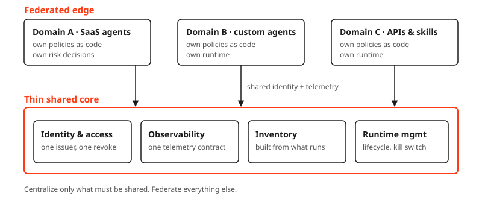
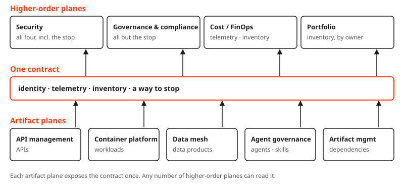
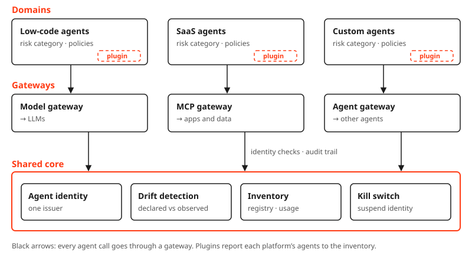

In the good old style of the Gang of Four, here is a pattern. It has a name, a context, the forces that pull it apart, a solution and its consequences. I have been using it for APIs for years, and it turns out to be exactly what AI agents need.

### Name

**Lightweight control plane.** Centralize only what must be shared. Federate everything else.

### Context

Organizations produce shared artifacts faster than any governance board can meet: APIs, event streams, data products, and now agents and skills. They do not live on one platform, and they never will.

A central team that reviews each one becomes the bottleneck, and teams route around it. Teams that govern alone produce a hundred incompatible answers to the same few questions. Who is this? What did it do? Does it still exist? How do I stop it?

I have built API management more than once, in very different organizations. Now I see the same story repeat with agents, MCP servers and skills. They appear in the wild faster than governance can follow, and the rush to catch up leaves the door open for supply-chain attacks. Leaving everything open and governing later does not work. Proxying package managers from day zero is the way.

### Forces

- **Central control vs. team autonomy.** The main one. Security, audit and cost want one place to look; teams want to ship without a ticket queue. Gregor Hohpe's [*Platform Strategy*](https://leanpub.com/platformstrategy) names the way out: platforms "reduce cognitive load without restricting choice."
- **Friction at volume.** At thousands of artifacts, nobody reviews each one by hand. Any step that adds friction gets routed around, so the compliant path has to be the easiest one.
- **Thinness.** Every capability added to the core makes it slower to change. Team Topologies calls the goal the *thinnest viable platform*.
- **Heterogeneity under regulation.** There is no single runtime, and each vendor brings its own console. Yet you must show who did what, on whose behalf, with which data — consistently across all of them.
- **Some answers only make sense if they are shared.** An identity is useless if every team issues its own. Telemetry is useless if it cannot be correlated.

### Solution

Split the control plane into a thin shared core and a federated edge.

**Centralize four things, and only these:**

1. **Identity and access.** Every artifact gets its own machine identity. When it acts for a human, it carries both: its own identity and the delegated user context, through token exchange or on-behalf-of flows. One issuer, one way to revoke.
2. **Observability.** One telemetry contract, ideally OpenTelemetry, so a trace means the same thing everywhere.
3. **Monitoring and inventory.** The registry of what exists, derived from what actually runs, not from what someone filled into a form.
4. **Runtime management.** Lifecycle and the kill switch. The plane does not kill processes on runtimes it does not own; it revokes the identity and blocks at the gateway. If something misbehaves, there is one place to stop it.

**Federate everything else:**

- **Policies.** On top of a small mandatory baseline that every domain inherits — no unmasked personal data to public model endpoints, say — each domain writes its own policies as code and contributes them by pull request. The baseline comes from governance and compliance. The plane enforces both; it authors neither.
- **Runtimes.** Use any platform that can carry the shared identity and emit the shared telemetry.
- **Decisions.** Risk acceptance sits with the domain that owns the outcome.
- **Maintenance of the control plane itself.** Inner-sourced, with stewards from the consuming teams. A central team that owns the plane alone will slowly grow it back into a heavy one.

The plane exists to close one specific gap: the distance between what an artifact *declared* at build time and what it is *observed* doing at runtime. Identity tells you who it is, telemetry tells you what it did, the inventory holds what it promised. Everything else is local.

#### Artifact-agnostic

Nothing above is specific to one artifact type. The same four questions apply to all of them.

| | Identity | Observability | Inventory | Runtime management |
|---|---|---|---|---|
| **API** | Client credentials per consumer | Gateway traces | API catalog from gateway traffic | Revoke key, deprecate version |
| **Container workload** | Workload identity | Cluster and service-mesh telemetry | Running workloads, not manifests in a repo | Scale to zero, quarantine namespace |
| **Data product** | Product and consumer identities | Access and quality metrics | Catalog from actual reads and writes | Revoke access, deprecate version |
| **Agent** | Own agent identity, plus delegated user context | GenAI traces, tool calls | Registry from runtime traces | Kill switch, suspend identity |
| **Skill** | Signed publisher identity | Invocation and version telemetry | Registry from install and use | Yank version, block install |
| **Dependency** (artifact management) | Signed publisher and build provenance | Resolution and download telemetry | SBOMs from what is actually deployed | Yank version, block in the proxy repository |

#### One contract, many control planes

API management, the container platform, the data mesh, agent governance and artifact management are each a lightweight control plane for their own artifacts. They all expose the same small contract: identities, telemetry, inventory and a way to stop.

Above them sit the higher-order planes, and there is more than one. Security, governance and compliance, cost and the application portfolio all read from the same contract. None of them reaches into the API gateway or the agent registry. Each takes only what it needs:

- **Security** needs all four, and it is the only one that needs the stop.
- **Governance and compliance** need evidence: who, what, and what exists. Not a switch.
- **Cost** needs telemetry and inventory, tagged with an owner.
- **Portfolio** needs the inventory, grouped by owner and application. It is derived, not maintained.

Each artifact plane exposes the contract once. A new higher-order plane costs the artifact planes nothing. And one kill switch can suspend an identity everywhere, because every artifact plane honors the same identity.

### Consequences

**Benefits**

- It scales with volume, because nothing in the core depends on a human reviewing each artifact.
- Teams keep their speed and their platform of choice.
- The core stays small, so it is cheap to run and hard to turn into a bottleneck.
- Audit evidence is consistent across vendors, because it comes from the shared identity and telemetry, not from each console.

**Liabilities**

- The central team loses its veto. Some organizations will find this the hardest part.
- Platforms that cannot carry the shared identity or emit the telemetry become second-class. That is a feature in procurement, and a pain in the first year.
- Federated policies drift. You still need a small mandatory baseline that every domain inherits.
- Shared ownership of the plane can become no ownership. Name the stewards.

**Related patterns**

The shape will look familiar: a service mesh separates the control plane from the data plane, data mesh calls it federated computational governance, and Team Topologies asks for the thinnest viable platform. This pattern applies the same idea across every artifact type, agents included.

### Example: AI agent governance

Here is the pattern applied to agents. Agent governance is one of the artifact planes; it exposes the same contract as the others.

- **Domains** own their agents, their platform, the risk category and the policies, written as code.
- **Plugins** are thin adapters, one per platform, that report agents to the inventory.
- **Gateways** are the enforcement points: they check identity, run the domain's policies and record the audit trail.
- **Agent identity** gives every agent its own machine identity. When it acts for a user, it carries that user's delegated context too.
- **Drift detection** compares what an agent declared with what it actually does.
- **Inventory** is the registry and usage view, built from what runs.
- **Kill switch** suspends an identity, and every gateway stops the agent at once.

The gateways are the interesting part. They are the enforcement points of the core, but the policies they run come from the domains. The plane owns the mechanism; the domains own the rules.

The MCP gateway matters most. It is where an agent gets access to tools, where tool arguments are validated, and where data leaving through a tool call can be caught.

### Closing words

We did this before with APIs. Gateways won because they were thin, not because they were clever. Agents, skills and whatever comes next deserve the same treatment: a small shared core that everyone can trust, and freedom everywhere else.
