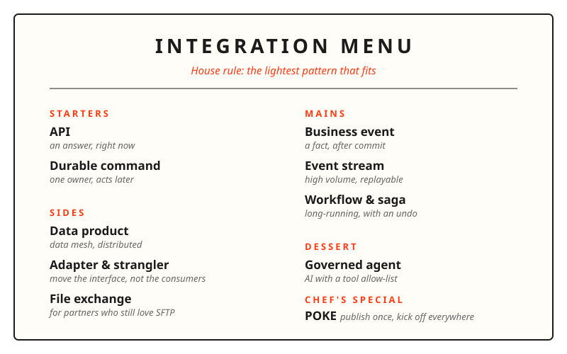
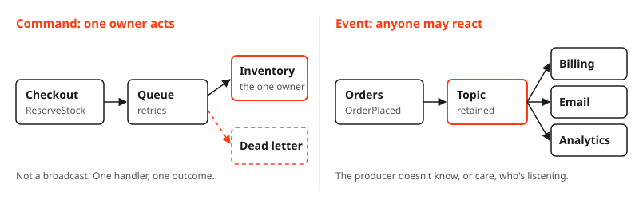
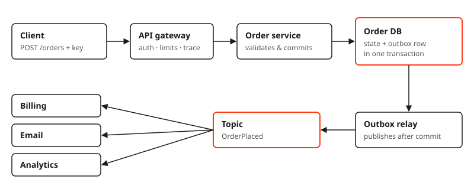
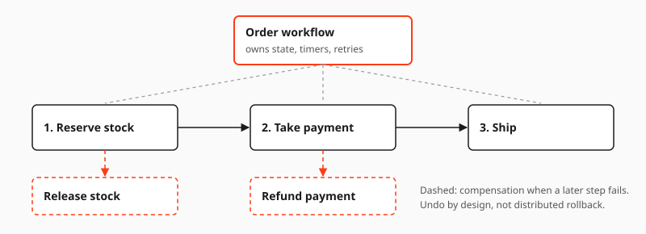
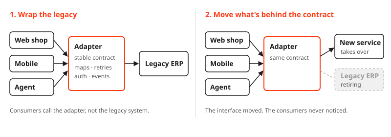
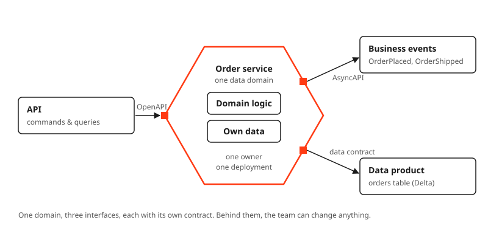
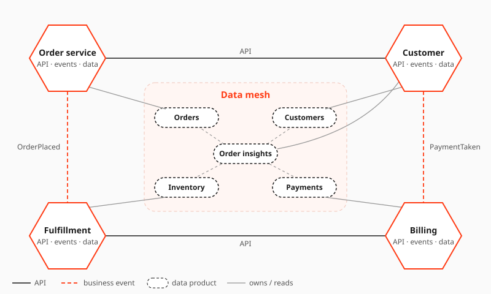

What makes a good integration? For me, it's the one nobody talks about, because it just works. Over the years I've seen many of those quiet heroes, and they almost always share the same few patterns underneath.

So I pulled together the set of integration patterns I keep picking. I think of it as a good restaurant menu: short, structured, every dish has a purpose, and the waiter knows which one fits *you*.

### The one rule

> **Use the lightest pattern that will fit.**

Lightest means the simplest pattern that still does the job. Not the most powerful one, and not the tool your platform team just bought. To find it, ask a few questions:

- Does someone need the answer right now?
- Is it one record or a constant stream?
- Does the process run for days?
- Do you know who will consume it, or will new consumers show up later?
- What will you need to prove afterwards?

The answers point to the pattern. Pick the technology after that.

### Request and command

#### API: an answer, right now

When you need an answer immediately or you need to validate a command in real time an API is still the way to go. You need to have a proper contract (OpenAPI), explicit timeouts and an **idempotency key** on every write that could be retried. A retried `POST /orders` should never result in two orders.

What an API shouldn't do is have the caller wait while five slow systems do their thing.

#### Durable command: one owner, acts later

Sometimes you just want one particular owner to do something (but not necessarily immediately). A `ReserveStock` will go onto a queue, the inventory service will pick it up, will retry a few times if necessary and then gracefully give up into a dead-letter queue.

The key word is *one*. A command is imperative intent with exactly one accountable handler. It is not a broadcast.

### Events and flow

#### Business event: a fact, after commit

Interfaces decouple by design, yet events make it the most obvious. An event simply says *something has happened*, e.g. `OrderPlaced`. It's in the past tense, it's immutable and it's only published once the owning service has committed the state. Zero, one or fifty consumers may react and the producer doesn't care a damn about any of them.

Publishing after commit sounds simple, but it's two steps: save the state to the database, then publish the event to the broker. If the service crashes in between, the state is saved but the event is lost, and your systems silently drift out of sync. The fix is old, boring, and it works: the **transactional outbox**. Write the state and the outgoing event in the same database transaction, and let a relay publish it afterwards.

#### Event stream: high volume, replayable

When volume is the reason for the design (clickstream, telemetry, change data capture) you want a partitioned stream. Ordering is held per key, the consumers maintain their own offsets and you can replay. A stream isn't a work queue and it isn't a workflow engine so please don't ask it to be one.

#### Workflow and saga: long-running, with an undo

Some processes take days. They have timers, human approvals and steps that can fail at any point. That state needs a home and that home is a **durable workflow**. It's not someone's inbox. It's not a spreadsheet. It's not the front end.

A saga gives you compensation, not magic. If the payment fails you release the stock. Undo by design, not by distributed rollback.

### Data and boundaries

#### Data product: database integration, done right this time

Remember the days when every system would just read from a shared database? We called that database integration and we all fought the bottleneck. The odd thing is that in a way it's coming back with **data mesh**. It's distributed this time and it's got manners.

In a data mesh each domain owns its data and publishes it as a **data product** (with an owner, a contract, quality, freshness and a lifecycle). Platforms such as Databricks are all in favour of **Delta tables** as the sharing surface (open, versioned tables that other domains can query, join and even time travel directly). It's the old school database integration in spirit, just the table is now a *published* contract rather than someone's private schema.

#### File exchange: for partners who still love SFTP

Yes files are still a valid pattern. Some partners simply can't do APIs and some packages are simply too big to be re-packaged. We all know about the nightly CSV that eventually becomes business critical. That's perfectly fine as long as the exchange is *managed* (identity, checksums, immutable raw copy, validation and a quarantine path). An unmanaged file drop is not a pattern, it's a liability.

#### Adapter and strangler: move the interface, not the consumers

Every company has *that* system: a vendor model, no events, a SOAP interface from another era. It's a system that everyone else has to adapt to. You can flip that round though.

An adapter is a piece of middleware with one job: fiddle with the legacy so nobody else has to. It translates the vendor model, uplifts authentication, retries the flaky calls, and maybe turns polling into events.

The next level: once consumers talk to the adapter's contract instead of the legacy system, **the interface can move**. Behind the contract, you can replace the old system piece by piece, and the consumers never notice.

That is the **strangler pattern**, named after the strangler fig, which grows around its host tree until it can stand on its own. You strangle the old system slowly, one capability at a time:

Wrap it, observe the real traffic, migrate the consumers to the contract, replace the capability behind it, and retire the old one. The last step is the one most teams forget. An adapter without a retirement plan is just a new legacy system.

### Service design: microservices

Put all this together into a **self-contained component**. Define it around a full data domain (a family of data products), its business events, and the interfaces that reflect the interactions between parties, with its own contract, owner, and deployment (I wrote about [my take on the self-contained application](/blog/my-take-on-the-self-contained-application) a while ago). These form the microservices that build a distributed landscape, one that can evolve at the pace of the business.

If you take the **Order service**, then this service is in charge of the entire order lifecycle and of its associated data. It provides an API for commands and queries (through a `POST /orders` and a `GET /orders/{id}`), sends out business events (such as `OrderPlaced` and `OrderShipped`), and makes the `orders` data product available for use in analytics. There are three interfaces, a single owner, and a single deployment. Behind these interfaces, the team are free to make any changes they like.

Zoom out, and it gets interesting. The data products form a mesh in the centre. Services then develop around them: they take ownership of some of the products, combine others, and communicate with one another via APIs and events. Gradually, the overall picture turns into a network of services, each one offering all three interfaces.

### Agents: the new kids on the block

> *An AI agent is software that works toward a goal on its own: it reads its environment, decides what to do, and acts, with more or less human oversight.*

AI agents are the new kids on the block, the next iteration of [open systems architecture](https://en.wikipedia.org/wiki/Open_systems_architecture). They have similar needs to microservices, yet act differently. They get their own identity, an allow-list of approved tools (MCP over real APIs and workflows), an audit trail for every tool call, and a human approval step for anything sensitive. No direct database writes and no admin credentials. An agent should never be the easiest way around your controls.

### One to watch: POKE

Agents are impatient. They poll and poll: is it done yet, has it changed? **POKE** (Publish Once, Kickoff Everywhere), a pattern from [Tom Hacohen at Svix](https://www.svix.com/poke/), answers that with one append-only event log per customer. Consumers read it by pull, resuming from their own cursor, or by push through signed webhooks, with the same event IDs and ordering on both paths. Missed a webhook? Just pull from where you stopped. It's the outbox and the business event from above, packaged for a world of agents. I go deeper in [Reshape your APIs for demanding AI agents](/blog/reshape-your-apis-for-ai-agents).

### The rules underneath

The patterns change, but these rules don't:

- **Contract before technology.** Agree on meaning, owner, and errors before you pick the broker.
- **Design for retries.** Assume at-least-once delivery. Make consumers idempotent.
- **The domain owns the truth.** Integrate through published contracts, never through someone's private tables.
- **Make failure visible.** Timeouts, dead letters, reconciliation, and trace context across every hop.

### Closing words

This is not a complete list. It's more like a menu for a certain taste: the patterns that have served me well. None of them is new, and they are boring in the best possible way. The craft is not knowing *all* of them. It's knowing which one fits, and having the courage to pick the light one.

*Keep it light, and keep it boring!*
