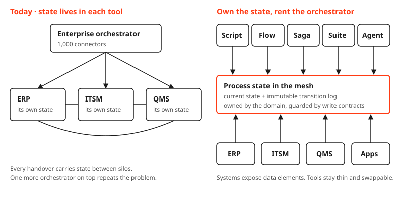

An architecture meeting this week had three tool requests in under an hour. One team wanted a low-code workflow tool. Another wanted a BPMN engine. Someone sensibly asked why not just use the big suite we already pay for. All three were right about the tool. None of them asked where the state would live, and that turned out to be the whole conversation.

### What a process really is

Strip a process to its parts and three things are tangled together.

- **Decisions.** Approve, reject, escalate. Every decision needs data combined from several places.
- **State.** Somebody has to know where a case is right now. Waiting for approval, sent to the supplier, blocked.
- **Handovers.** Work moves from one team, one system, one inbox to the next.

The first two create value. The third does not. Handovers exist because the state is trapped in one system and the next decision needs it in another. The flowchart on the wall is mostly the trace of state being carried between silos.

For twenty years, that carrying was the job. State machines, process managers and sagas were the elegant part. The integration underneath was the expensive part: connectors, mappings, retries, and data flows that never quite stayed stable. Most of the effort went into moving state around, not into making better decisions.

### "Agents will solve this"

They will solve a lot of it. With current frontier models, a basic integration is a prompt away. A saga spec or a state machine is an afternoon of vibe-coding. The small automation tasks that filled that meeting are becoming too cheap to argue about.

The pitch usually goes further: let the agent run the whole long process, end to end. That's where it breaks. Long processes run for weeks. [METR](https://metr.org/notes/2026-01-22-time-horizon-limitations/) measured frontier models finishing tasks of a few hours about half the time, and warns that this is not a threshold for delegation. The orchestration vendors agree, for their own reasons. Their guidance puts agents inside a governed workflow, never as the orchestrator.

So yes, agents. But not as the new place where state lives.

### Every suite wants your state

Look at the market and the pattern is obvious. Every platform wants to be the top layer. The ERP suite embeds a workflow tool for its agents. The service management platform sells a control tower for any agent. Process mining grows an orchestration engine. Each one absorbs process state into its own product.

That would work if a company ran on one suite. None does. There is always an ERP, a service desk, a quality system, a CRM and a long tail of homegrown apps. Several suites each absorbing state means orchestrating across them, and the integration mess is back. Buying a bigger orchestrator to sit above them repeats the mistake one level up.

The mess doesn't come from a missing super-orchestrator. It comes from where the state lives.

### Put the state in the mesh

This was the moment the meeting turned. Process state is data. Treat it like any other data product.

Each domain owns the state of its processes as an operational data product in the mesh: the current state of every case, plus an immutable log of every transition. Who moved it, from what, to what, and why. Systems expose the data elements a process needs to the mesh. The state is managed there, not inside any tool.

Once the state is decoupled, the orchestrator is just a tool that reads state, decides, and writes a transition. You own the state. You rent the orchestrator.

### Then anything can sit on top

A script. A low-code flow. A saga engine for the parts that need compensation. The suite, for the work it's good at. An agent.

They become interchangeable, and that changes what you ask of each one.

The agent doesn't have to stay reliable across a six-week process. It has to make one correct transition and hand back. The next step can be another agent, a human, or a twenty-line script. Nobody needs a thousand connectors, because nobody carries state between systems anymore. Everyone reads it from the same place.

Decisions land in the same log, whoever makes them. In regulated work, a human sign-off is simply another authorized writer, and the transition log is the audit trail. Traceability isn't bolted on afterwards. It is the shape of the data.

And the handovers start to disappear. When every team reads the same state, there is nothing to hand over. People and agents collaborate around one case instead of passing it down a line.

### Yes, but here's how

Decoupling the state doesn't make the hard parts go away. It moves them to one place, where they can be solved once.

1. **Write contracts.** Who may move a case from A to B, and under which conditions? This is the part of the orchestrator you can't rent. Model it as data, enforce it at the state product, and version it like an API.
2. **Operational, not analytical.** Most mesh implementations are built for analytics and run on yesterday's data. Process state has to be live. That means operational data products with events, not a nightly batch.
3. **Name the owner of cross-domain state.** A process that spans procurement, quality and finance still needs one domain that owns its state. The mesh doesn't remove the ownership question. It makes it impossible to dodge.
4. **Compensation still needs a trigger.** Someone has to notice a failed step and start the undo. That can be a saga engine or an agent, but the rule belongs in the write contract.
5. **Keep the layer thin.** Open formats, events and contracts. The moment "put the state somewhere else" means buying a state platform, you have rebuilt the enterprise integrator under a new name.

The shared floor underneath is identity, permissions on transitions, telemetry and a way to stop. That is the same [lightweight control plane](/blog/lightweight-control-plane) I use for APIs and agents. Nothing new is needed there.

### Closing words

The question in that meeting was which tool. The better question is where the state lives. Answer that first, and the tool becomes a cheap, replaceable choice. Sometimes a suite, sometimes a script, more and more often an agent.

Next time someone asks for an orchestrator, ask where the state of the process will live. If the answer is "inside the tool", you are buying your next integration project.
