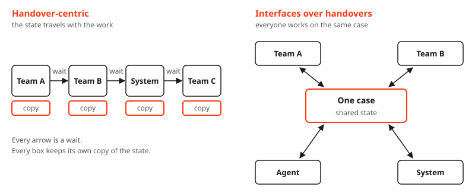
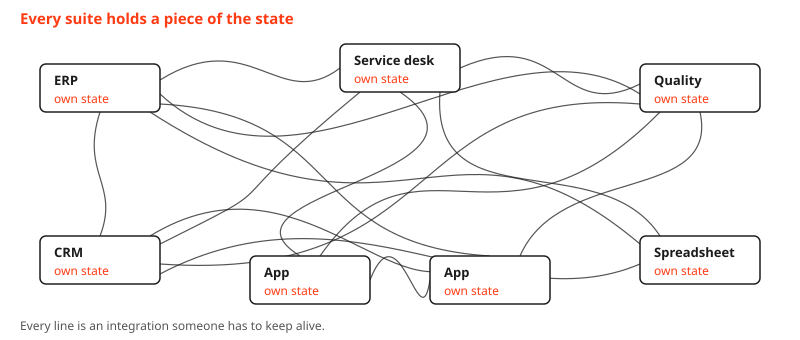
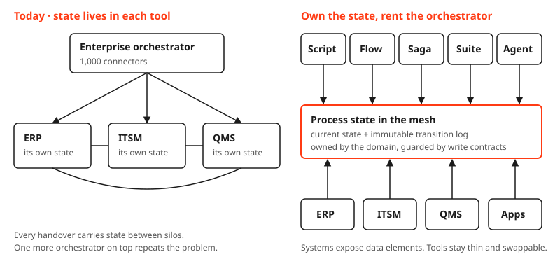
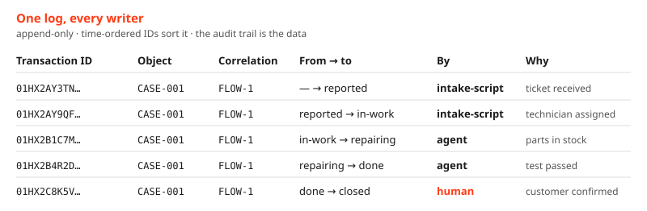

Let's stop building automations and start building companions that work alongside people.

To get there, we first have to step out of the tool religions. Low-code flows, BPMN engines, the big suite we already pay for, and now agent harnesses. Every camp has an answer, and every answer wants to own the process.

Some say [put the agents in harnesses](https://www.linkedin.com/feed/update/urn:li:activity:7522268397041287170/) and let a workflow engine drive them. The harness becomes swappable. The workflow engine still owns the state, so the lock-in just moves one layer up.

Decouple the state from both. Keep it outside the harness and outside the orchestrator, as an immutable history anyone can read. Then the harness and the orchestrator become replaceable workers on top of state you own.


### Design for the users

Today the user is a person or an AI agent, often both on the same case. Take the tools away and the value is plain: knowledge reuse, decisioning and state management. Use what we already know, make good decisions, and always know where a case stands.

Today we get there through handovers. Work moves from one team, one system, one inbox to the next, and each handover exists only because the state is stuck somewhere else. The handover itself adds nothing.

So the design goal is frictionless interaction instead of handover-centric design. Interfaces over handovers.



### Agents open up new frontiers

A basic integration is a prompt away. A saga spec or a state machine is an afternoon of vibe-coding. An agent can read the messy input, pull the knowledge together and propose the decision. Those are the parts that used to sit in someone's inbox.

The harness is where that work happens. It brings the tools, the context, the permissions and the agent loop. The model reasons, the harness executes, and an orchestrator can pick the right harness for the job. That's one more thing we don't have to build ourselves.

What an agent shouldn't do is carry a six-week process in its head. Models get better every quarter, so this isn't about capability. A six-week process is mostly waiting: sessions end, models get swapped, people go on holiday, and an auditor wants the record, not the context window. An agent should make one correct transition, record why, and hand back. Which leaves the question every tool camp answers for you: where does the state live?


### Every suite wants your state

Every platform wants to be the top layer. The ERP suite embeds a workflow tool for its agents, the service management platform sells a control tower for any agent, and process mining grows an orchestration engine. Each one pulls process state into its own product.

That works if a company runs on one suite, and none does. There is always an ERP, a service desk, a quality system, a CRM and a long tail of homegrown apps. When each suite holds its own piece of the state, you end up orchestrating across them, and the integration mess is back. A bigger orchestrator on top just repeats the mistake one level up.



The mess doesn't come from a missing super-orchestrator. It comes from where the state lives.

### Put the state in the mesh

Process state is data. Treat it like any other data product.

By mesh I mean operational data products owned by the business domain: live, event-driven state, not a nightly analytical copy and not a service mesh.

Each domain owns the state of its processes as an operational data product in the mesh: the current state of every case, plus an immutable log of every transition. Who moved it, from what, to what, and why. Object and transaction IDs anchor every transition, and correlation IDs tie the flow together. Systems expose the data elements a process needs to the mesh. The state is managed there, not inside any tool.



Once the state is decoupled, the orchestrator is just a tool that reads state, decides, and writes a transition. You own the state. You rent the agent, the orchestrator, the suite.

### Everything on top stays thin

Once the state lives in the mesh, it stops being rows in someone's database. It becomes business objects: a repair case, the asset being repaired, the parts it needs. They link to each other, and each one carries its current state and its history.

On top of those objects you need only two thin things.

**Actions** are the only way to change the state: open, start, repair, finish, close. Each action knows who may run it and what it needs, and every run writes one transition to the log. A script, a low-code flow, a saga engine, the suite or an agent can all call the same action. That's what makes them interchangeable. Nobody needs a thousand connectors, because nobody carries state between systems anymore.

**Applications** are views built for one purpose. A technician gets a work queue, a supervisor gets a close-out screen, an agent gets an API or an MCP tool. They all read the same objects and call the same actions, so you can build one in a day, tune it, or throw it away without touching the process.


People and agents work on the same objects through the same actions. A human sign-off is just an action with a stricter rule, and in regulated work the transition log is the audit trail. Traceability isn't bolted on afterwards. It is the shape of the data.



And the handovers start to disappear. When every team works on the same objects, there is nothing to hand over. People and agents collaborate around one case instead of passing it down a line.

### Let's make it real

Enough theory. [lucid-comet](https://github.com/zsim0n/lucid-comet) is a thin, runnable example. It started as an [intent.md](https://github.com/zsim0n/lucid-comet/blob/main/intent.md), a coding agent took it from spec to code, and the whole repair process fits in one file of data:

```json
{
  "open":   { "from": [],            "to": "reported",  "writers": ["intake-script", "agent", "human"] },
  "start":  { "from": ["reported"],  "to": "in-work",   "writers": ["intake-script", "agent", "human"] },
  "repair": { "from": ["in-work"],   "to": "repairing", "writers": ["agent", "human"] },
  "finish": { "from": ["repairing"], "to": "done",      "writers": ["agent", "human"] },
  "close":  { "from": ["done"],      "to": "closed",    "writers": ["human"] }
}
```

The state of a case is derived from an append-only log, and the same `repair` action runs from a script, an agent or a person. Try `close` as the agent, and the contract refuses. Governance lives in the contract, not in the prompt.

The example stays thin on purpose. In a real landscape, decoupling the state doesn't make the hard parts go away. It moves them to one place, where they can be solved once:

- **Live state.** Operational and event-driven, never a nightly copy.
- **One owner.** Every process, cross-domain ones included, has one domain that owns its state.
- **IDs on every transition.** Object, transaction and correlation IDs. Retries reuse the transaction ID, and resuming means reading the log.
- **Compensation in the contract.** A failed step triggers its undo. The rule lives in the contract, not in the tool.
- **Federated operations.** Each domain runs its own state product on the same thin core of identity, permissions, telemetry and a way to stop: the [lightweight control plane](/blog/lightweight-control-plane).

### Closing words

The usual question is which tool. The better question is where the state lives. Answer that first, and the tool becomes a cheap, replaceable choice. Sometimes a suite, sometimes a script, more and more often an agent.

If this sounds familiar, it is. Event sourcing did it for systems, Redux did it for front ends: one place for state, every change an appended action, and everything else a replaceable view on top.

Next time someone asks for an orchestrator, ask where the state of the process will live. If the answer is "inside the tool", you are buying your next integration project.
