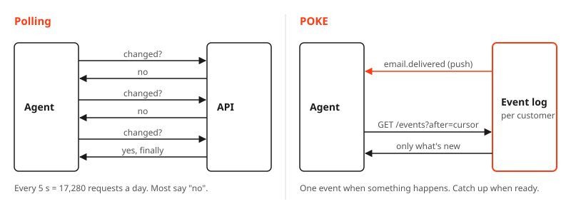
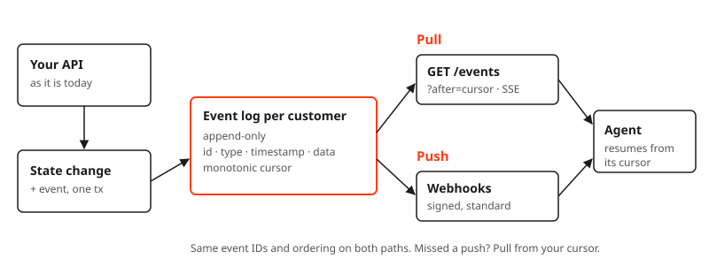
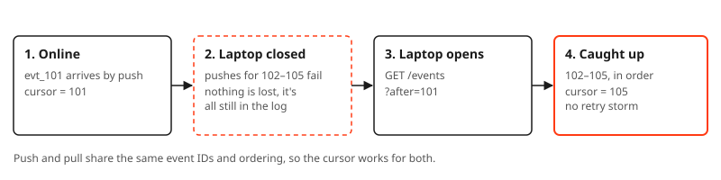
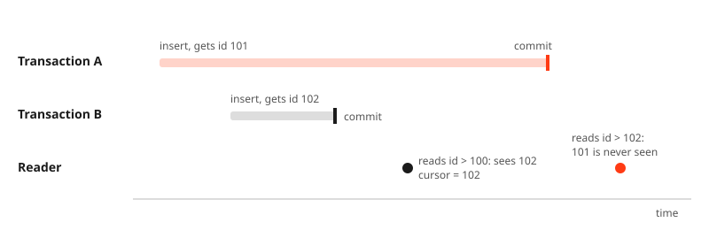
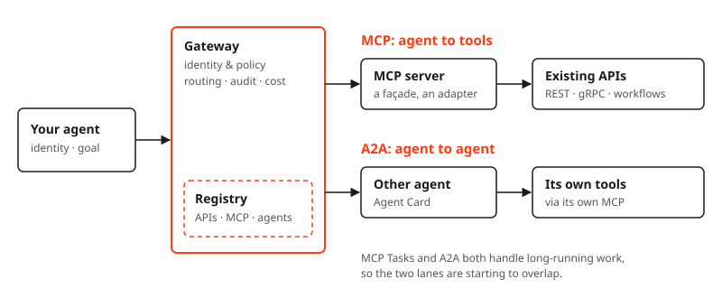
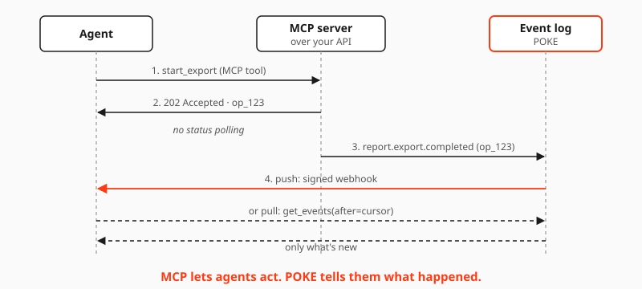

Do this. Is it done yet? What changed? Is it done *now*? Let me validate the result.

That is how an AI agent talks to your API, every few seconds, forever. Agents are becoming our busiest API consumers, and most of our APIs were never designed for them. Here is a pattern that fixes the worst of it, and where it sits next to MCP.

### The polling tax

Tom Hacohen, founder of Svix and co-creator of [Standard Webhooks](https://www.standardwebhooks.com/), put numbers on it in his talk [*How Agents Are Going to Kill Your Service*](https://www.youtube.com/watch?v=w_jShOmYcPY). Cloudflare saw agent traffic grow 20x in one year. And agents don't just call more; they iterate, verify, spawn sub-agents, and keep an eye on things all day.

An agent polling every 5 seconds makes about 17,000 requests a day. Almost all of them answer "nothing changed". Poll less often, and you pay in latency. There is no sweet spot. And polling is lossy too: most APIs don't tell you what was deleted, and a change that flips back between two polls is simply gone.



Webhooks help, but they need a public, always-on endpoint. An agent on a laptop is neither. Close the lid, and the deliveries fail. Open it, and you get a storm of retries from twelve hours ago.

### POKE in one sentence

[**POKE**](https://www.svix.com/poke/) (Publish Once, Kickoff Everywhere) is Tom's lightweight answer, "EDA for the rest of us":

> Write every meaningful change once, to an append-only event log per customer, and let consumers read it by pull or by push.



Four tenets:

- **Simple.** One append-only store. No new broker, no framework.
- **Reliable.** A consumer resumes from its cursor and never misses or reorders an event.
- **Secure.** Events are scoped per customer. Pulls need the customer's auth; pushes are signed.
- **Interoperable.** Pull is plain HTTP. Push follows Standard Webhooks.

### One log, two doors

The key design choice: push and pull share **the same event IDs and ordering**. Webhooks are the fast path. The pull endpoint is the safety net. A consumer that was offline doesn't need a retry storm; it just reads from where it stopped.



Reading is one boring HTTP call:

```http
GET /events?after=evt_1041&types=email.*
```

```json
{
  "data": [
    {
      "id": "evt_1042",
      "type": "email.delivered",
      "timestamp": "2026-10-19T12:00:03Z",
      "data": { "email_id": "em_77", "status": "delivered" }
    }
  ],
  "next_cursor": "evt_1042"
}
```

Slow work follows the same path. Return `202 Accepted` with an operation ID for the long export, then emit `report.export.completed` or `report.export.failed` on the log, carrying that ID. Keep `GET /operations/{id}` as a fallback, not the main signal.

### How to build it

1. Find the slow and async operations: emails, exports, renders.
2. Find the events your customers would react to: `user.signed_up`, `payment.failed`.
3. Add an append-only event log per customer, written **in the same transaction** as the state change.
4. Expose a cursor-based `GET /events`, then feed your webhooks from the same log.

You never rewrite your API. You add the log right next to it. If you read my [favorite integration patterns](/blog/my-favorite-integration-patterns), you will recognize the parts: the transactional outbox, past-tense business events, idempotent async work. POKE is those, packaged as one small contract that an agent can use without a broker, a dashboard, or a public endpoint.

Postgres is a fine place to start:

```sql
create table events (
  id          bigserial primary key,
  customer_id bigint      not null,
  type        text        not null,  -- e.g. email.delivered
  payload     jsonb       not null,
  created_at  timestamptz not null default now()
);
create index on events (customer_id, id);
```

### The cursor trap

One detail bites almost everyone. A plain `bigserial` is **not** a safe cursor. The ID is assigned at insert, but the row only becomes visible at commit. Two concurrent transactions, and a reader can move past an event forever:



The fix is boring and solid. Serialize writers per customer, so commit order matches ID order:

```sql
-- inside the same transaction as the state change
select pg_advisory_xact_lock(:customer_id);
insert into events (customer_id, type, payload) values (:customer_id, :type, :payload);
```

Alternatives: read only up to the oldest open transaction, or let a single writer, such as a Kafka consumer partitioned by customer, assign the IDs. Svix even ships a skill, [POKE.md](https://www.svix.com/POKE.md), that lets a coding agent audit your service for exactly these things.

### Where MCP fits

POKE is how our systems answer agents. **MCP** is how agents get in, and it grew up fast this year. The [2026-07-28 specification](https://blog.modelcontextprotocol.io/posts/2026-07-28/) made it stateless, routable by gateways through HTTP headers, discoverable up front, and extensible through optional add-ons such as Tasks for long-running work. That's no longer a laptop plug. That's an API protocol.

Next to it, **A2A** connects agents to other agents, and it reached 1.0 this spring. Gartner notes that MCP Tasks and A2A now overlap, while product support lags, so you have time. Don't bet on either one. Bet on the patterns underneath.



Two things I'd take away:

- **Put MCP in front, not instead.** Keep your REST, gRPC, and GraphQL APIs. An MCP server is a façade, the adapter pattern again.
- **It's API governance, again.** Registry, discovery, ownership, approvals, quotas, lifecycle: the agent management checklist is the API management checklist. As Gartner put it, if AI pushed you to fix data governance, agents must push you to fix API governance.

The open gap is the contract. There is no OpenAPI for agents yet. [MCP Server Cards](https://modelcontextprotocol.io/seps/2127-mcp-server-cards) are a start: they tell a client where a server lives and how to connect, but deliberately not what its tools do. Describing what an agent can do, what it costs, and what it does with your data is still unsolved.

### MCP and POKE together

So how do they play together? **MCP lets agents act. POKE tells them what happened.** The agent asks or acts through an MCP tool. Your system answers through the event log.

Take a long export:

1. The agent calls the `start_export` tool. Your API answers `202 Accepted` with `op_123`.
2. Instead of calling a status tool every five seconds, the agent waits.
3. When the export is done, the service writes `report.export.completed` for `op_123` to the log.
4. The agent gets it by webhook, or with one pull from its cursor, for example through a `get_events(after=cursor)` tool.



If you read my [favorite integration patterns](/blog/my-favorite-integration-patterns), this is the Order service hexagon again: MCP plays the API, POKE plays the business events. Same architecture, now facing agents. And MCP's own Tasks extension is still poll-based (`tasks/get`), which is exactly where the POKE idea could help.

### Closing words

Agents don't need a new architecture. They need the one we already know, facing a demanding new customer: contracts, outboxes, and events. MCP and POKE are simply the newest names for them.

*Publish once. Let the impatient ones come to you.*

References:
- [POKE overview, Svix](https://www.svix.com/poke/) and [POKE.md](https://www.svix.com/POKE.md)
- [How Agents Are Going to Kill Your Service, Tom Hacohen at Supabase Select 2026](https://www.youtube.com/watch?v=w_jShOmYcPY)
- [What Breaks When Agents Become the Customer, Chain of Thought ep. 78](https://chainofthought.show/podcast/78-what-breaks-when-agents-become-the-customer-svix-ceo-tom-hacohen/)
- [Standard Webhooks](https://www.standardwebhooks.com/)
- [MCP specification 2026-07-28](https://blog.modelcontextprotocol.io/posts/2026-07-28/)
- [SEP-2127: MCP Server Cards](https://modelcontextprotocol.io/seps/2127-mcp-server-cards)
