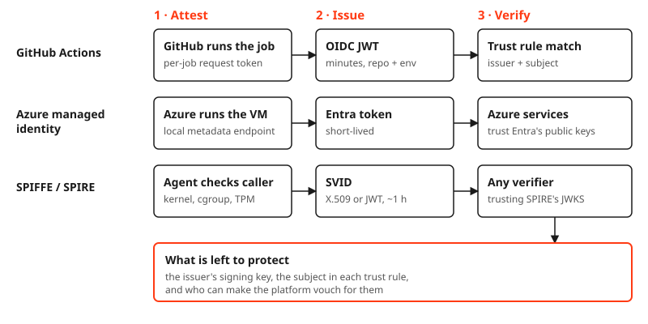

The first time a GitHub Actions pipeline deployed to production without a single client secret in it, I enjoyed it more than I'd like to admit. No vault entry. No expiry date in a calendar. No "who rotated this last?" thread. Just an ID, a tenant and a green tick.

Then the architect in me asked the annoying question. OAuth always needs proof. So where did the secret go?

It didn't go anywhere. It moved. Once you see where, you know what you actually have to protect.

### The proof is still there

Classic client credentials are simple: the app holds a `client_secret` and presents it. Whoever holds the string *is* the app. That's exactly why it leaks: it gets copied into repo secrets, pipeline variables, laptops and chat threads.

Federation keeps the OAuth exchange and swaps the proof. Instead of a stored secret, the workload presents a short-lived token signed by a platform that already knows who it is. With GitHub Actions:

1. A job starts with `id-token: write`, and GitHub injects a per-job request token into the runner. It lives as long as the job.
2. The job uses it to ask GitHub's issuer for an OIDC JWT. Its subject names the repo and environment, `repo:org/repo:environment:prod`, and it expires in minutes.
3. The job sends that JWT to the identity provider or the target platform as a client assertion.
4. The receiver fetches GitHub's public keys, checks the signature, and matches issuer and subject against a trust rule someone configured.
5. A match returns a normal access token. Same OAuth, different proof.

The secret is GitHub's private signing key. It never leaves GitHub. You never see it, and neither does your pipeline.

### Same move, three platforms

This isn't a GitHub trick. It's one pattern: a platform that runs the workload attests it, issues a short-lived signed credential, and publishes the public half so anyone can verify.

Azure managed identity does it for VMs through a local metadata endpoint. **SPIFFE**, the CNCF standard for workload identity, and **SPIRE**, its reference implementation, do it anywhere: an agent on each node checks the calling process through the kernel (UID, cgroup, pod, image hash), and the node itself proves its identity with a TPM. GitHub does it for jobs because GitHub started the job.

That's how **secret zero** gets solved. You can't hand a workload its first secret without creating a secret. So you don't. You let something that already knows the workload vouch for it.

### What genuinely got better

Secretless is a real improvement, and it's worth being precise about why:

- **Nobody on your side holds the key.** Copying was how secrets leaked. There's nothing to copy.
- **One key instead of many.** N client secrets with N expiry dates become one issuer key that the issuer rotates.
- **What travels is short and narrow.** A leaked token lasts minutes and names one audience and one subject.
- **The configuration is public.** Issuer, subject, audience: you can commit the trust rule to Git and review it like code.

### Relocated risk, clear trust boundaries

Here's the part the "no more secrets" pitch skips. The risk doesn't disappear, it relocates. The question changes from *who can read the secret?* to *who can make the issuer vouch for them?* The good news: the new boundaries are clear, and each one has an owner.

Three of those boundaries are yours to manage.

**The subject.** A trust rule is only as narrow as its subject. `repo:org/repo:environment:prod` means one environment in one repo, behind approval rules. `repo:org/*` means every repo in the organization can become your production identity. That's a shared password with better branding.

**Whatever lets someone become that subject.** If anyone who can push to the branch can trigger the prod job, your branch protection is now your credential. Environment approvals, required reviewers and repo admin rights are the access control. On SPIRE, the equivalent is the agent socket's permissions and a distinct UID per workload.

**Who can edit the trust rule.** A federated credential on an app registration, or a federation policy on the target platform, decides which outside identity becomes yours. Whoever can change it can add their own subject. It deserves the review you used to give the vault.

At the root, you trust the issuer's key: GitHub's, your cloud provider's, or your own SPIRE server's CA. That's a deliberate choice, not a free lunch.

### Where it stops

Secretless ends where the target system stops accepting federated identity. Plenty of SaaS APIs and legacy databases only take an API key or a password. The SPIFFE world's answer is an egress broker: the workload proves itself to a vault such as OpenBao, which mints a 15-minute database user or injects the stored key into the outbound request. The app never sees it. The key still exists. It just moved again, to a place built to hold it.

### Questions to ask your vendors

The usual SaaS onboarding checklist asks for SSO, MFA, RBAC and SCIM. That covers your people. It says nothing about your workloads, and that's where the secrets hide. "We support secretless" is easy to put on a slide; add these questions under the same headings to see whether it's real.

#### Identity and access management

- Can your platform accept a federated token from an issuer we choose (GitHub, our cloud, our own SPIFFE server), or only your own credentials?
- Can a trust rule pin the exact subject and audience, not just the issuer? Can we manage those rules as code, through an API or Terraform?
- How long do your issued tokens live, and can we shorten it? Can a single identity be revoked immediately?
- When your service acts on behalf of a user, does it carry both its own identity and the user's, or does it collapse into one?

#### Data security and privacy

- Which of your features still need a static key or password? Where do those live, and who rotates them?
- Where are your signing keys kept, how are they rotated, and how will we know if one is compromised?

#### Application governance

- Do your audit logs record which external identity and subject each token was exchanged for, and can we export them?

If the honest answer to the first question is "no", the rest doesn't matter yet. You will be storing a secret for them.

### Closing words

Use secretless everywhere it's offered. Just call it what it is: a relocation of trust, from a string you rotate to permissions you review.

Next time someone tells you a pipeline "has no secrets", ask to see the subject on its trust rule, and who can push to the branch that matches it. That's where the secret lives now.

*Next: the same pattern on a real data platform, where one client ID is the only thing anyone copies.*
